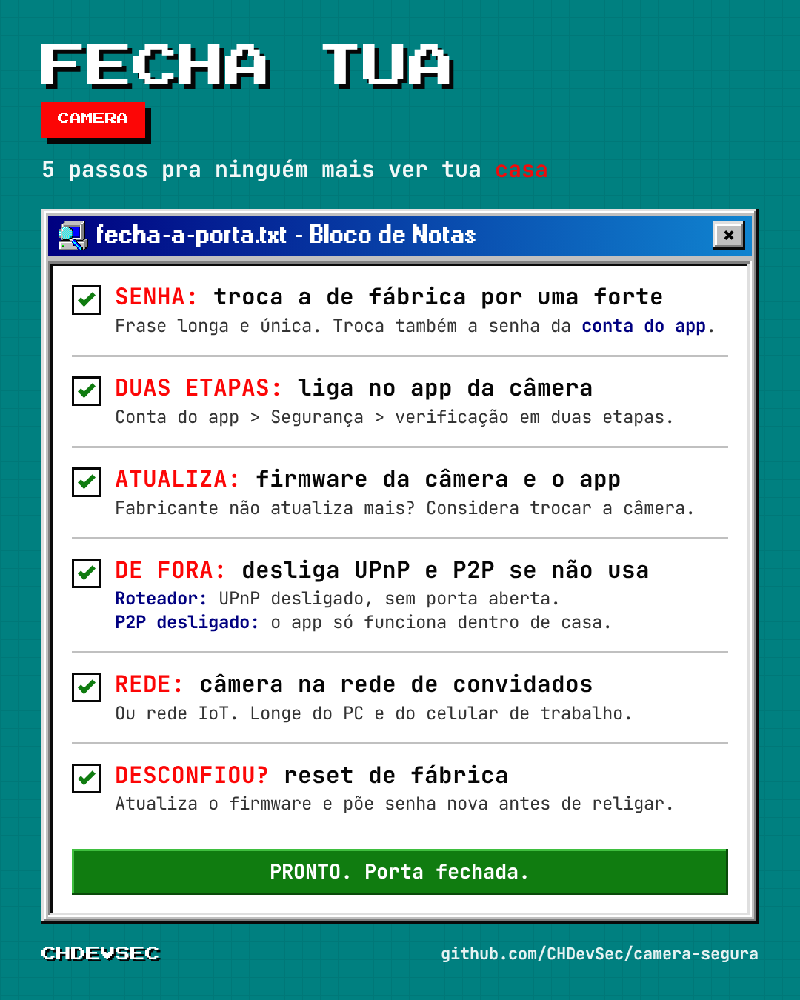

# camera-segura

**Tu botou câmera em casa pra ficar mais seguro. Mas se a senha dela ainda é a de fábrica,
pode ter mais gente vendo. Aqui tu entende como isso acontece e fecha a porta em 15 minutos.**

Guia da [CHDEVSEC](https://chdevsec.com.br) pra quem tem câmera IP em casa, na loja ou no
quarto do bebê. O foco é **conscientização e defesa**: nada aqui ensina a entrar na câmera de
ninguém. Ver [ETICA.md](ETICA.md).

Baixa o card em [PNG](defesa/camera-card.png) ou [PDF](defesa/camera-card.pdf) e manda pra
família. **Checklist pra aplicar hoje:** [`defesa/checklist.md`](defesa/checklist.md)

## O problema, em 3 partes

### 1. Senha de fábrica
Muita câmera IP barata, principalmente modelo mais antigo, sai da caixa com usuário e senha
padrão (`admin` / `admin`, `admin` / `12345`, sem senha...). E essa senha está **no manual**,
que está na internet pra qualquer um baixar.

Não é teoria antiga: em 2016 a botnet **Mirai** tomou centenas de milhares de câmeras e
gravadores usando só uma lista de **62 combinações de usuário e senha de fábrica**
([CISA, alerta TA16-288A](https://www.cisa.gov/news-events/alerts/2016/10/14/heightened-ddos-threat-posed-mirai-and-other-botnets)).

> Boa notícia: muita câmera nova (várias linhas de Hikvision e Dahua, por exemplo) já
> **obriga** a criar uma senha no primeiro acesso. Se a tua pediu, ótimo. Se nunca pediu,
> desconfia.

### 2. Acesso de fora de casa (P2P e UPnP)
Pra tu ver a câmera pelo celular na rua, ela precisa ser alcançável de fora. Isso costuma vir
**ligado de fábrica**, de dois jeitos:

- **P2P (nuvem do fabricante):** a câmera abre uma conexão de dentro pra fora com o servidor
  do fabricante e fica identificada por um **ID** (UID/serial). O app te conecta por esse ID.
  O P2P **não abre porta** no teu roteador, mas quem tiver o **ID + a senha** chega na câmera
  de qualquer lugar. E já houve falha no próprio sistema: a
  [CVE-2021-28372](https://nvd.nist.gov/vuln/detail/CVE-2021-28372) (ThroughTek Kalay,
  usada em milhões de câmeras) permitia sequestrar a conexão
  ([CISA ICSA-21-229-01](https://www.cisa.gov/news-events/ics-advisories/icsa-21-229-01)).
- **UPnP / porta aberta:** a câmera pede pro roteador abrir uma porta e fica **direto na
  internet**, com IP e porta. Aí qualquer um que varre a internet encontra a página de login.

**Senha de fábrica + acesso de fora ligado = porta aberta.**

### 3. E acontece de verdade, em escala
No começo de novembro de 2026 foi noticiado um vazamento que expôs links de acesso a cerca de
**17 mil câmeras**, sem senha, por 5 dias. O caso é outro mecanismo (links sem senha), mas o
recado é o mesmo: câmera acessível pela internet é risco real.

## Sinais de que podem estar vendo a tua câmera
- O app mostra **outro usuário** ou **outro aparelho** conectado que tu não reconhece.
- A câmera **mexe sozinha** (giro/PTZ), o LED acende sem tu abrir o app, ou **fala** sozinha.
- A senha **parou de funcionar** do nada.
- O histórico de acesso (quando o app tem) mostra horário em que tu não abriu.

Viu um desses? Vai direto pro passo 6 (reset).

## Fecha a porta (passo a passo)

1. **Troca a senha de fábrica por uma forte e única.** Frase longa, que tu não usa em nenhum
   outro lugar. Troca também a senha da **conta do app** e, se existir, a do RTSP/ONVIF.
2. **Liga a verificação em duas etapas** na conta do app/nuvem, se tiver.
3. **Atualiza o firmware** da câmera e o app. Se o fabricante **não manda mais atualização**,
   considera trocar a câmera: falha conhecida em modelo abandonado não vai ser corrigida.
4. **Desliga o UPnP no roteador** e **não abre porta** (redirecionamento) pra câmera.
5. **Desliga o P2P / acesso remoto se tu não vê a câmera de fora de casa.**
   ⚠️ Efeito colateral: com o acesso remoto desligado, **o app só funciona dentro de casa**.
   Se tu precisa ver de fora, mantém ligado, mas com os passos 1 a 3 feitos.
6. **Bota a câmera numa rede separada** (a rede de convidados ou IoT do roteador serve), longe
   do computador e do celular de trabalho.
   ⚠️ Em alguns roteadores a rede de convidados isola os aparelhos e o app **não acha a câmera**
   na rede de casa. Se acontecer, configura pelo app de fora ou usa uma VLAN/rede IoT.
7. **Desconfia que já entraram?** Reset de fábrica, firmware atualizado e senha nova **antes**
   de religar na rede.

Detalhes e o porquê de cada passo: [`defesa/checklist.md`](defesa/checklist.md)

## Perguntas rápidas

**"Minha câmera é de marca, tô seguro?"** Marca ajuda (senha obrigatória, atualização), mas
senha fraca repetida e app sem duas etapas derrubam qualquer marca.

**"Desligar o P2P resolve tudo?"** Fecha uma porta grande, mas não substitui senha forte e
firmware em dia. E lembra do efeito colateral (só funciona em casa).

**"Tapo a câmera quando tô em casa?"** Pra câmera interna (quarto, sala), um obturador físico
ou desligar da tomada quando tu tá em casa é a defesa mais simples que existe.

## Licença
MIT, ver [LICENSE](LICENSE). Feito pela CHDEVSEC pra ensino de segurança e privacidade na prática.
